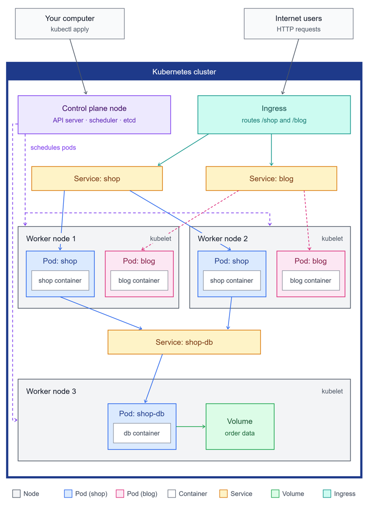

# 3.11 Kubernetes diagram

A Kubernetes cluster with one control plane node and three worker nodes,
running two applications: an online shop and a blog.

- The developer deploys the apps from their own computer with `kubectl`.
- HTTP requests from the internet reach the Ingress, which routes `/shop`
  and `/blog` to the matching Service, which forwards them to the pods.
- Shop pods reach the database through the `shop-db` Service; the
  database stores order data in a Volume.

